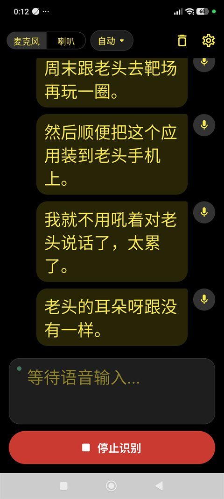
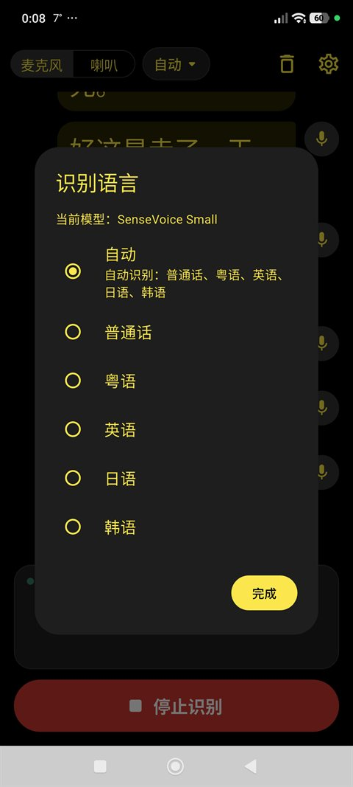
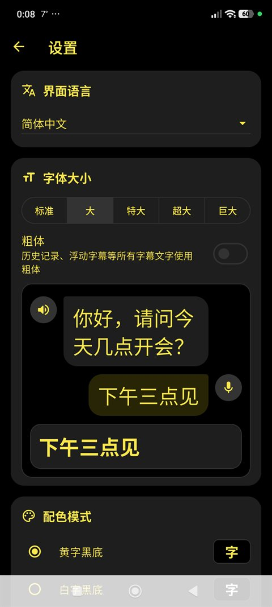
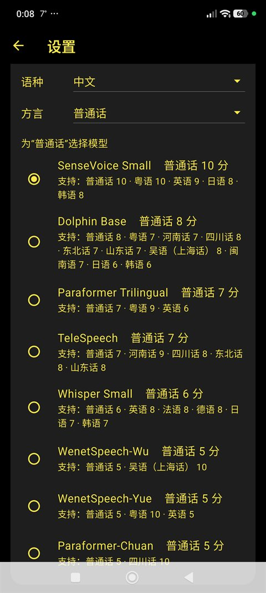

# 伊利斯之视 · Visio Iridis

**专为听障人士设计的离线实时语音字幕应用**

[](https://github.com/godvmxi/VisioIridis/releases)
[](https://github.com/godvmxi/VisioIridis/releases)
[](LICENSE)

[English →](README_EN.md) | [繁體中文 →](README_TW.md)

---

## 简介

Visio Iridis 是一款面向听障人士的实时语音转字幕工具。核心设计原则是**完全离线运行**——语音识别在本地设备完成，无需联网，无需将任何语音数据上传至服务器，保护用户隐私。

### 主要特性

- **完全离线**：识别引擎运行于设备本地，无网络亦可正常使用
- **实时转写**：低延迟语音识别，字幕即说即显
- **多语言支持**：普通话、粤语、英语同时识别
- **双音源**：支持麦克风（周围声音）和系统播放声音（媒体字幕）
- **后台浮窗**：切到其他应用时保持字幕悬浮显示
- **无障碍优先**：字号、字重可调，高对比度配色

---

## 截图

| 实时字幕 | 识别语言 | 字体与预览 | 选择模型 |
|---|---|---|---|
|  |  |  |  |

---

## 下载

前往 [Releases](https://github.com/godvmxi/VisioIridis/releases) 页面下载最新 APK。每个版本提供以下几种安装包，请按需选择**一个**安装：

| 安装包 | 内置模型 | 适合 | 模型大小 |
|---|---|---|---|
| `VisioIridis-<版本>.apk` | 无（首次使用时下载） | 网络通畅，想按需选择模型 | — |
| `VisioIridis-<版本>-SenseVoiceSmall-Mandarin-Cantonese-English-Japanese-Korean.apk` | SenseVoice Small | 普通话、粤语、英语、日语、韩语，**大多数用户推荐** | 约 240 MB |
| `VisioIridis-<版本>-WenetSpeechYue-Cantonese.apk` | WenetSpeech-Yue | 粤语为主（兼顾普通话、英语） | 约 135 MB |
| `VisioIridis-<版本>-WenetSpeechWu-Wu-Shanghainese.apk` | WenetSpeech-Wu | 吴语 / 上海话为主（兼顾普通话） | 约 133 MB |
| `VisioIridis-<版本>-WhisperSmall-Multilingual.apk` | Whisper Small | 英语、法语、德语等多语种 | 约 375 MB |
| `VisioIridis-<版本>.aab` | 无 | 应用商店上架用，个人无需下载 | — |

- **内置模型版**安装后无需联网即可直接使用，适合网络不便（如大陆访问 HuggingFace 困难）或给老人、盒子等设备预装的场景。安装包体积会相应增大。
- 第一次开始识别时，App 会把内置模型从安装包中复制出来并校验，需要几秒到几十秒，之后不再重复。
- 各安装包功能完全相同，内置模型版仍可在设置中切换到其他模型（届时联网下载）。

---

## 构建

需要 Flutter 3.47+：

```bash
flutter pub get
flutter build apk --release
```

构建内置模型版时，先用 [tool/bundle_model.py](tool/bundle_model.py) 下载并校验模型（模型 id 见 `assets/config/model_config.json`），再正常构建：

```bash
python3 tool/bundle_model.py sense-voice-small-int8
flutter build apk --release
```

脚本会改写 `assets/bundled_models/manifest.json`，请勿提交该改动。推送 `v*` tag 时，GitHub Actions 会自动构建上述全部版本并发布到 Releases。

---

## 路线图

以下功能正在规划或调研中，大致按优先级排列，不代表具体版本承诺。

### 🌐 更多语言支持
在普通话 / 粤语 / 英语之外扩展更多语种和方言。候选模型将在设备端体积与识别精度之间权衡，以维持离线优先的核心原则。

### 💾 音频存储与会话归档
可选地在本地录制并保存音频，同时保留对应的转写文本。用户可回放会话、回顾内容，并将字幕导出为文本文件。本地存储为默认行为，云备份需用户主动开启。

### 🔁 在线模式——轻量语义纠错
当检测到网络连接且用户**主动开启**时，离线转写结果可发送至云端 ASR 或 LLM 进行后校正，修复同音字、标点错误及上下文歧义等离线模型的常见问题。此模式**仅限用户手动触发**，界面有明确标识，绝不自动激活。适合对精度有较高要求、能接受少量流量消耗的场景。

### 🔁 在线模式——全量音频重录分析
同样为可选功能：将录制好的完整音频上传至高精度云端模型重新转写。适用于重要会议、医疗问诊等对准确性要求高于实时性的场合。上传时机由用户决定，取回结果后可删除远端副本。

### 🎧 蓝牙配件 / 电话 / 视频会议音频
Android 与 iOS 系统不向第三方应用开放通话音频或 VoIP 音频的录制接口。我们正在调研通过配套蓝牙硬件（如颈挂式设备或助听器桥接模块）将音频直接传入应用的方案，以绕过系统限制，实现电话、FaceTime、Zoom 等场景下的实时字幕。

### 👤 发言人识别（说话人分离）
在转写文本中区分多位说话人（说话人 A / 说话人 B……），使用设备端说话人分离模型，保护隐私。初期聚焦双人对话场景，后续扩展至多人会议。

### 📱 iOS 支持
当前版本仅支持 Android。待 Android 功能稳定后将跟进 iOS 适配。主要挑战在于 iOS 对系统音频捕获的限制，需通过 Broadcast Upload Extension 等机制解决。

---

## 技术栈

- Flutter（Android）
- [sherpa-onnx](https://github.com/k2-fsa/sherpa-onnx) — 本地语音识别引擎
- Riverpod — 状态管理

---

## 名字的由来

**Iris**，希腊神话中的彩虹女神，也是奥林匹斯诸神的传信使者——她穿行于神与人之间，将声音与口信准确传递。

**Visio**，拉丁语，意为"视觉"、"所见之物"。

合在一起：**Visio Iridis**，彩虹之视——像彩虹桥一样，跨越声音与视觉之间的鸿沟，将别人说出的话，完整地呈现在眼前。

感谢 **LT** 为这个名字赋予了灵魂。

---

## 大陆用户说明

受网络环境限制，大陆用户在使用时可能遇到以下问题，以下是当前的解决方案和计划。

### 模型下载

App 内置了双下载源，**优先尝试 HuggingFace，自动切换 hf-mirror.com 镜像**，大多数情况下无需任何操作即可完成下载。若两者均无法访问，可通过以下方式手动解决：

- 开启代理/VPN 后重试
- 后续版本计划增加 ModelScope（魔搭）作为第三下载源

### APK 下载

GitHub Releases 在大陆访问可能较慢。备选方案：

- 使用 [ghproxy](https://ghproxy.link) 等 GitHub 代理加速下载
- 后续计划在国内平台（如 Gitee / 蒲公英）同步发布

### 远程配置更新

App 每 24 小时检查一次远程配置（用于推送新模型版本）。若无法访问，App 会继续使用本地缓存配置，**不影响正常使用**。

---

## 关于这个项目

Visio Iridis 是一款**公益软件**，免费、开源，核心目的只有一个：让听障人士能更轻松地参与日常对话与生活。

这个项目的灵感，来自一位带我走进射击运动的老顽童——他有严重的听力障碍，却用行动告诉我，听不见不妨碍热爱生活。希望这款软件，能让更多像他一样的人少一点障碍，多一点自在。

感谢 **Larry、LT、Tom、Swan** 在早期开发中给予的鼓励与测试支持。

---

## 参与贡献

欢迎提交 Issue 和 Pull Request。如果你是听障用户，对使用体验有任何反馈，请直接开 Issue——来自当事人的真实体验是这个项目最宝贵的输入。

我们也在寻找各语种的朋友加入内测团队，帮助验证多语言识别效果。如果你有兴趣，请在 Issue 中留言或发邮件联系。

---

## 许可证

本项目采用 [GNU 通用公共许可证第 3 版（GPL-3.0）](LICENSE) 授权：

- ✅ 任何人都可以自由使用、学习、修改和再分发本软件
- 🔁 分发本软件或其修改版本时，必须以 GPL-3.0 公开完整源代码，并保留版权和许可证声明
- ⚠️ 本软件按“原样”提供，不附带任何担保

本软件使用的第三方组件（如 sherpa-onnx）和识别模型各自遵循其原有许可证。
