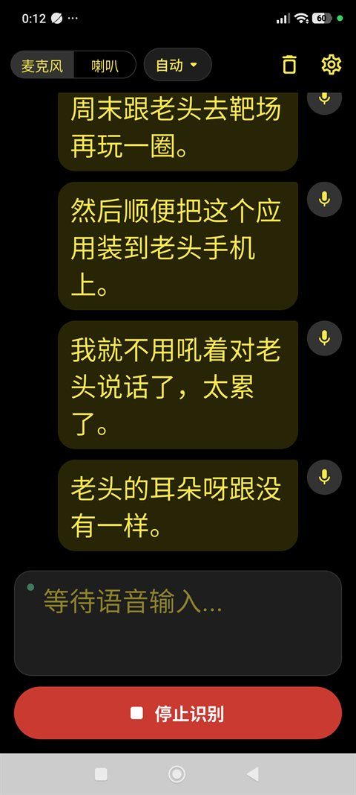
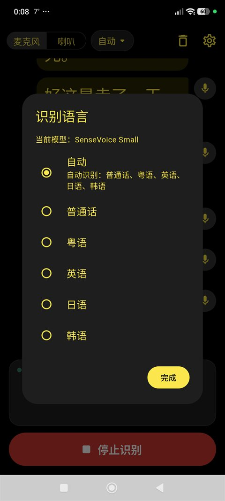
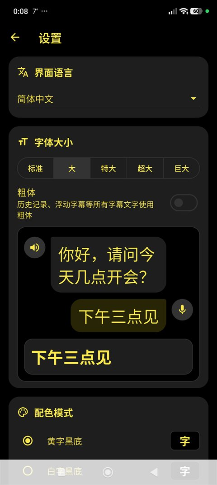
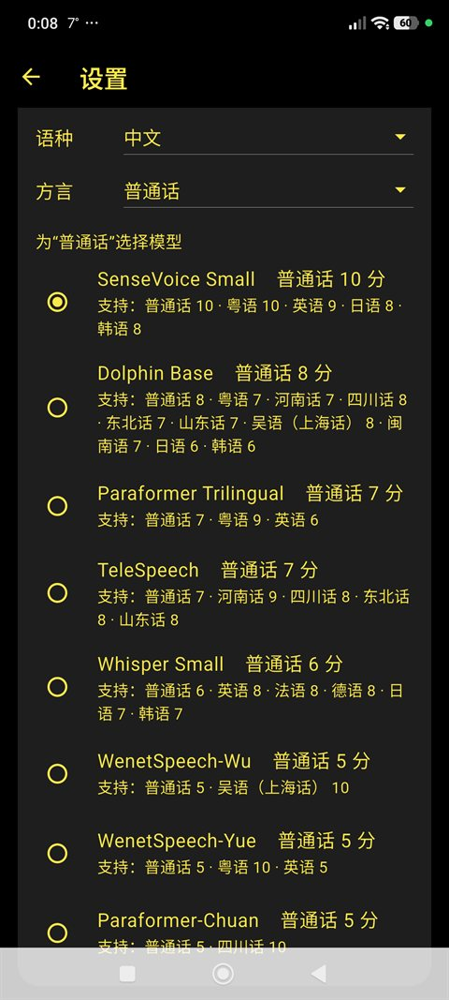

# Visio Iridis · 伊利斯之视

**Real-time offline speech captioning — designed for the deaf and hard of hearing**

[](https://github.com/godvmxi/VisioIridis/releases)
[](https://github.com/godvmxi/VisioIridis/releases)
[](LICENSE)

[简体中文 →](README.md) | [繁體中文 →](README_TW.md)

---

## Overview

Visio Iridis is a real-time speech-to-caption tool built for people who are deaf or hard of hearing. Its foundational design principle is **offline-first**: speech recognition runs entirely on the local device — no internet required, no audio ever leaves the phone, full privacy guaranteed.

### Current Features

- **Fully offline** — recognition engine runs on-device, works without any network connection
- **Real-time transcription** — low-latency ASR, captions appear as words are spoken
- **Multilingual** — Mandarin, Cantonese, and English recognized simultaneously
- **Dual audio sources** — microphone (ambient sound) or system audio (media playback captions)
- **Background overlay** — captions float above other apps when Visio Iridis is in the background
- **Accessibility-first** — adjustable font size, weight, and high-contrast color themes

---

## Screenshots

| Live captions | Recognition language | Font & preview | Model choice |
|---|---|---|---|
|  |  |  |  |

---

## Download

Get the latest APK from the [Releases](https://github.com/godvmxi/VisioIridis/releases) page. Each release ships several packages — install **one** of them:

| Package | Built-in model | Best for | Model size |
|---|---|---|---|
| `VisioIridis-<version>.apk` | None (downloaded on first use) | Good connectivity; pick models as needed | — |
| `VisioIridis-<version>-SenseVoiceSmall-Mandarin-Cantonese-English-Japanese-Korean.apk` | SenseVoice Small | Mandarin, Cantonese, English, Japanese, Korean — **recommended for most users** | ~240 MB |
| `VisioIridis-<version>-WenetSpeechYue-Cantonese.apk` | WenetSpeech-Yue | Mainly Cantonese (also Mandarin, English) | ~135 MB |
| `VisioIridis-<version>-WenetSpeechWu-Wu-Shanghainese.apk` | WenetSpeech-Wu | Mainly Wu / Shanghainese (also Mandarin) | ~133 MB |
| `VisioIridis-<version>-WhisperSmall-Multilingual.apk` | Whisper Small | English, French, German and other languages | ~375 MB |
| `VisioIridis-<version>.aab` | None | For app-store publishing; not needed by users | — |

- **Built-in model packages** work right after install with no network — useful where HuggingFace is hard to reach, or when preinstalling on a TV box or a relative's phone. The package is larger accordingly.
- The first time you start recognition, the app copies the built-in model out of the package and verifies it. This takes a few seconds to a minute and happens only once.
- All packages have the same features; a built-in model package can still switch to another model in Settings (it will be downloaded then).

---

## Build

Requires Flutter 3.47+:

```bash
flutter pub get
flutter build apk --release
```

To build a built-in model package, first download and verify the model with [tool/bundle_model.py](tool/bundle_model.py) (model ids are in `assets/config/model_config.json`), then build as usual:

```bash
python3 tool/bundle_model.py sense-voice-small-int8
flutter build apk --release
```

The script rewrites `assets/bundled_models/manifest.json`; don't commit that change. Pushing a `v*` tag makes GitHub Actions build all the packages above and publish them to Releases.

---

## Roadmap

The items below are planned or under investigation. They are roughly ordered by priority, though not all are committed to a specific release.

### 🌐 Broader Language Support
Expand beyond Mandarin / Cantonese / English to cover more languages and regional accents. Candidate models will be evaluated for on-device size vs. accuracy trade-offs to preserve the offline-first guarantee.

### 💾 Audio Storage & Session Archive
Optionally record and save audio sessions alongside the generated transcripts. Users would be able to replay a session, review what was said, and export the transcript as text. Storage is local by default; cloud backup would require explicit opt-in.

### 🔁 Online Mode — Lightweight Semantic Correction
When a network connection is detected and the user explicitly enables it, the offline transcript can be forwarded to a cloud ASR or LLM endpoint for lightweight post-correction — fixing homophones, punctuation, and context errors that on-device models miss. This mode is **opt-in only**, clearly labeled, and never activates automatically. Designed for users in low-noise, low-bandwidth situations where a small correction pass adds meaningful value without large data costs.

### 🔁 Online Mode — Full Audio Re-analysis
Also opt-in: upload a recorded session to a high-accuracy cloud model for a complete re-transcription. Intended for important meetings or medical consultations where accuracy matters more than immediacy. The user controls when to upload and can delete the remote copy after retrieval.

### 🎧 Bluetooth & Call / Video-Conference Audio
Android and iOS do not expose call audio or third-party VoIP audio to recording APIs. We are investigating hardware-assisted workarounds — such as a companion Bluetooth accessory (e.g., a neckband or hearing-aid bridge) that passes audio directly into the app, bypassing OS restrictions. This would enable real-time captions during phone calls, FaceTime, Zoom, and similar apps.

### 👤 Speaker Identification (Diarization)
Distinguish multiple speakers in the transcript (Speaker A / Speaker B …) using on-device diarization. Particularly useful in group conversations, doctor visits, and meetings. The initial implementation will focus on two-speaker scenarios before scaling to larger groups.

### 📱 iOS Support
The current release targets Android only. iOS support is planned once the Android feature set stabilises. The main challenge is system audio capture, which is restricted on iOS without a special Broadcast Upload Extension.

---

## Tech Stack

- Flutter (Android)
- [sherpa-onnx](https://github.com/k2-fsa/sherpa-onnx) — on-device speech recognition engine
- Riverpod — state management

---

## The Name

**Iris** is the goddess of the rainbow in Greek mythology, and the divine messenger of the Olympians — she moved between the gods and mortals, carrying voice and word across the divide.

**Visio** is Latin for "sight" or "that which is seen."

Together: **Visio Iridis** — Vision of the Rainbow. Like a rainbow bridge, it spans the gulf between sound and sight, placing what is spoken directly before the eyes.

Special thanks to **LT** for giving this name its soul.

---

## Notes for Users in Mainland China

Due to network restrictions, users in mainland China may encounter difficulties in the following areas. Here is the current status and planned improvements.

### Model Downloads

The app ships with **two download sources**: it tries HuggingFace first and automatically falls back to **hf-mirror.com**, a mainland-accessible mirror. This means most users should be able to download models without any extra steps. If both sources fail, the options are:

- Enable a VPN/proxy and retry
- A third source — [ModelScope (魔搭)](https://modelscope.cn) — is planned for a future release

### APK Download

GitHub Releases can be slow or unreliable from mainland China. Alternatives:

- Use a GitHub proxy such as [ghproxy](https://ghproxy.link) to accelerate the download
- Releases on a domestic platform (Gitee / pgyer) are planned

### Remote Config Updates

The app checks for a remote config update every 24 hours (used to push new model versions). If the remote URL is unreachable, the app silently falls back to its local cached config — **normal use is not affected**.

---

## About This Project

Visio Iridis is a **non-profit, free and open-source** app. Its only purpose is to make everyday conversation a little easier for people who are deaf or hard of hearing.

The inspiration came from an old friend who introduced me to shooting sports — a man with severe hearing loss who showed me, through his own joy and energy, that not being able to hear doesn't stop you from living fully. This app is built for people like him.

Special thanks to **Larry, LT, Tom, and Swan** for their encouragement and early testing support.

---

## Contributing

Issues and pull requests are welcome. If you are deaf or hard of hearing and have feedback on usability, please open an issue — lived experience is the most valuable input this project can receive.

We are also looking for beta testers who speak languages other than Mandarin, Cantonese, and English, to help validate multilingual recognition quality. If you are interested, leave a comment in an issue or reach out by email.

---

## License

This project is licensed under the [GNU General Public License v3.0 (GPL-3.0)](LICENSE):

- ✅ Anyone may freely use, study, modify and redistribute the software
- 🔁 If you distribute the software or a modified version, you must release the complete source code under GPL-3.0 and keep the copyright and license notices
- ⚠️ The software is provided "as is", without any warranty

Third-party components (such as sherpa-onnx) and the recognition models remain under their own licenses.
