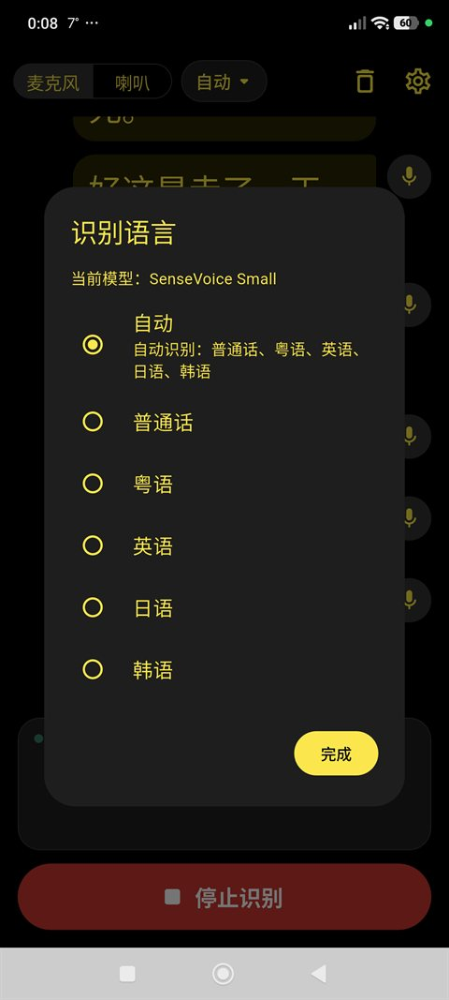
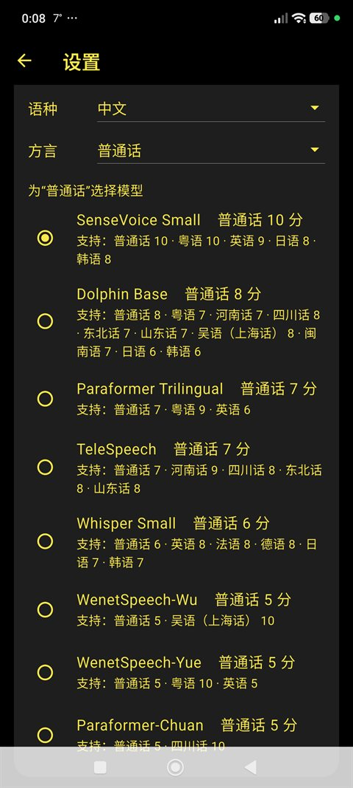

# 伊利斯之視 · Visio Iridis

**專為聽障人士設計的離線即時語音字幕應用**

[](https://github.com/godvmxi/VisioIridis/releases)
[](https://github.com/godvmxi/VisioIridis/releases)

[简体中文 →](README.md) | [English →](README_EN.md)

---

## 名字的由來

**Iris**，希臘神話中的彩虹女神，也是奧林匹斯諸神的傳信使者——她穿行於神與人之間，將聲音與口信準確傳遞。

**Visio**，拉丁語，意為「視覺」、「所見之物」。

合在一起：**Visio Iridis**，彩虹之視——像彩虹橋一樣，跨越聲音與視覺之間的鴻溝，將別人說出的話，完整地呈現在眼前。

感謝 **LT** 為這個名字賦予了靈魂。

---

## 簡介

Visio Iridis 是一款面向聽障人士的即時語音轉字幕工具。核心設計原則是**完全離線運行**——語音辨識在本地裝置完成，無需連網，不會將任何語音資料上傳至伺服器，完整保護用戶隱私。

### 主要特性

- **完全離線**：辨識引擎運行於裝置本地，無網路亦可正常使用
- **即時轉寫**：低延遲語音辨識，字幕即說即顯
- **多語言支援**：普通話、粵語、英語同時辨識
- **雙音源**：支援麥克風（周遭聲音）和系統播放聲音（媒體字幕）
- **背景浮窗**：切換至其他應用時保持字幕懸浮顯示
- **無障礙優先**：字型大小、字重可調，高對比度配色

---

## 截圖

| 即時字幕 | 辨識語言 | 字型與預覽 | 選擇模型 |
|---|---|---|---|
|  |  |  |  |

---

## 下載

前往 [Releases](https://github.com/godvmxi/VisioIridis/releases) 頁面下載最新 APK。

---

## 建置

需要 Flutter 3.47+：

```bash
flutter pub get
flutter build apk --release
```

---

## 路線圖

以下功能正在規劃或調研中，大致按優先級排列，不代表具體版本承諾。

### 🌐 更多語言支援
在普通話 / 粵語 / 英語之外擴展更多語種和方言。候選模型將在裝置端體積與辨識精度之間權衡，以維持離線優先的核心原則。

### 💾 音訊儲存與會話封存
可選地在本地錄製並儲存音訊，同時保留對應的轉寫文字。用戶可回放會話、回顧內容，並將字幕匯出為文字檔案。本地儲存為預設行為，雲端備份需用戶主動開啟。

### 🔁 線上模式——輕量語義校正
當偵測到網路連線且用戶**主動開啟**時，離線轉寫結果可發送至雲端 ASR 或 LLM 進行後校正，修復同音字、標點錯誤及上下文歧義等離線模型的常見問題。此模式**僅限用戶手動觸發**，介面有明確標示，絕不自動激活。適合對精度有較高要求、能接受少量流量消耗的場景。

### 🔁 線上模式——全量音訊重新分析
同樣為可選功能：將錄製好的完整音訊上傳至高精度雲端模型重新轉寫。適用於重要會議、醫療問診等對準確性要求高於即時性的場合。上傳時機由用戶決定，取回結果後可刪除遠端副本。

### 🎧 藍牙配件 / 電話 / 視訊會議音訊
Android 與 iOS 系統不向第三方應用開放通話音訊或 VoIP 音訊的錄製介面。我們正在調研透過配套藍牙硬體（如頸掛式裝置或助聽器橋接模組）將音訊直接傳入應用的方案，以繞過系統限制，實現電話、FaceTime、Zoom 等場景下的即時字幕。

### 👤 發言人辨識（說話人分離）
在轉寫文字中區分多位說話人（說話人 A / 說話人 B……），使用裝置端說話人分離模型，保護隱私。初期聚焦雙人對話場景，後續擴展至多人會議。

### 📱 iOS 支援
目前版本僅支援 Android。待 Android 功能穩定後將跟進 iOS 適配。主要挑戰在於 iOS 對系統音訊擷取的限制，需透過 Broadcast Upload Extension 等機制解決。

---

## 技術堆疊

- Flutter（Android）
- [sherpa-onnx](https://github.com/k2-fsa/sherpa-onnx) — 本地語音辨識引擎
- Riverpod — 狀態管理

---

## 關於這個專案

Visio Iridis 是一款**公益軟體**，免費、開源，核心目的只有一個：讓聽障人士能更輕鬆地參與日常對話與生活。

這個專案的靈感，來自一位帶我走進射擊運動的老頑童——他有嚴重的聽力障礙，卻用行動告訴我，聽不見不妨礙熱愛生活。希望這款軟體，能讓更多像他一樣的人少一點障礙，多一點自在。

感謝 **Larry、LT、Tom、Swan** 在早期開發中給予的鼓勵與測試支持。

---

## 參與貢獻

歡迎提交 Issue 和 Pull Request。如果你是聽障用戶，對使用體驗有任何回饋，請直接開 Issue——來自當事人的真實體驗是這個專案最寶貴的輸入。

我們也在尋找各語種的朋友加入內測團隊，幫助驗證多語言辨識效果。如果你有興趣，請在 Issue 中留言或發郵件聯繫。
